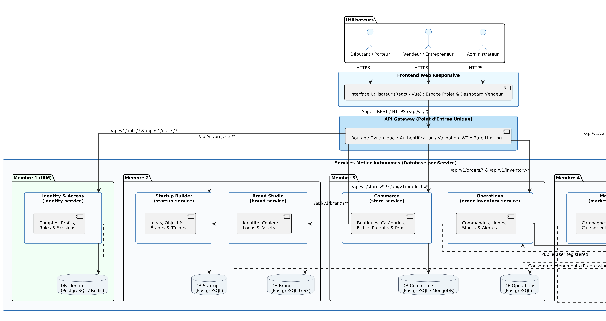

# Dossier Technique — Plateforme SaaS All-in-One
> **Projet AWD : Architecture Orientée Microservices**  
> **Livrable : Validation Intermédiaire (Séance 4)**  

---

## Sommaire
1. [Description du Sujet & Problématique](#1-description-du-sujet--problématique)
2. [Acteurs & Fonctionnalités par Module](#2-acteurs--fonctionnalités-par-module)
3. [Découpage en Microservices & Responsabilités](#3-découpage-en-microservices--responsabilités)
4. [Données & Propriété (Database per Service)](#4-données--propriété)
5. [Interactions & Protocoles de Communication](#5-interactions--protocoles-de-communication)
6. [Diagramme d'Architecture Globale](#6-diagramme-darchitecture-globale)
7. [API & Contrats d'Échange — Principes](#7-api--contrats-déchange--principes)
8. [Sécurité, Qualité & Choix Technologiques](#8-sécurité-qualité--choix-technologiques)
9. [Organisation Git & Répartition des Responsabilités](#9-organisation-git--répartition-des-responsabilités)

---

## 1. Description du Sujet & Problématique

### Contexte
Le projet consiste à concevoir une plateforme web SaaS tout-en-un destinée aux personnes qui souhaitent lancer une activité (porteurs de projet / débutants) et aux commerçants qui vendent déjà via Instagram, Facebook ou TikTok (Afrique du Nord : Tunisie, Algérie, Maroc, avec possibilité d'extension internationale). Aujourd'hui, ces utilisateurs sont contraints d'utiliser plusieurs outils séparés pour structurer leur idée, créer leur marque, présenter leurs produits, suivre les commandes, gérer les stocks et analyser leurs résultats.

### Proposition de Valeur
> *« De la première idée à la croissance de son activité : les outils essentiels réunis dans une seule plateforme. »*

- **Démarrer :** Guider un débutant dans la structuration de son idée et les premières étapes de lancement.
- **Centraliser :** Regrouper les informations de boutique, produits, commandes, stocks et marketing.
- **Améliorer :** Fournir des indicateurs utiles pour comprendre les performances et identifier des pistes d'amélioration.
- **Faire grandir :** Permettre à l'activité de gagner en organisation et de se développer progressivement (incluant un assistant IA sous contrôle de l'utilisateur).

---

## 2. Acteurs & Fonctionnalités par Module

### 2.1 Les Acteurs
| Acteur | Description | Principales Actions |
| :--- | :--- | :--- |
| **Visiteur** | Personne découvrant la plateforme sans compte | Consulter la présentation, découvrir les offres, créer un compte. |
| **Débutant / Porteur de projet** | Utilisateur souhaitant lancer son premier business | Créer un projet, suivre un parcours guidé, définir son offre, construire sa marque et préparer son lancement. |
| **Vendeur / Entrepreneur** | Utilisateur vendant déjà sur les réseaux sociaux ou via boutique | Gérer boutique, produits, commandes, stocks, clients, campagnes et indicateurs. |
| **Administrateur plateforme** | Responsable de l'exploitation et de la modération | Gérer les comptes, rôles, signalements, paramètres globaux et supervision technique. |

### 2.2 Modules Fonctionnels
- **Startup Builder :** Espace projet, description de l'idée, objectifs, cible, proposition de valeur, étapes et tâches de lancement.
- **Brand Studio :** Nom, slogan, couleurs, éléments d'identité, fichiers de marque, propositions assistées par IA.
- **Store Manager :** Création de boutique, catégories, fiches produits, prix, descriptions, images et statut de publication.
- **Order & Inventory Manager :** Enregistrement/suivi de commandes, mise à jour de statuts, suivi des quantités, mouvements et alertes de stock.
- **Marketing Studio :** Préparation de contenus, calendrier éditorial, suivi des campagnes et résultats.
- **Business Analytics :** Ventes, commandes, produits populaires, indicateurs de performance, filtrage par période.
- **AI Business Assistant :** Réponses aux questions, génération d'idées/textes, aide à l'interprétation des indicateurs.

---

## 3. Découpage en Microservices & Responsabilités

| Microservice | Responsabilité | Exemples de données possédées |
| :--- | :--- | :--- |
| **Identity & Access** | Inscription, connexion, profils, rôles et autorisations. | `User`, `Profile`, `Role`, `Permission`, `Session`, `Consent` |
| **Startup Builder** | Gestion des projets de création et de leur progression. | `Project`, `BusinessIdea`, `Goal`, `Milestone`, `Task`, `ProjectStatus` |
| **Brand Studio** | Gestion de l'identité de marque et de ses ressources. | `Brand`, `BrandName`, `Slogan`, `BrandColor`, `BrandAsset`, `LogoFile` |
| **Store Manager** | Gestion des boutiques et du catalogue produit. | `Store`, `Category`, `Product`, `ProductVariant`, `ProductImage`, `Price` |
| **Order & Inventory** | Gestion des commandes, lignes de commande et stocks. | `Order`, `OrderItem`, `InventoryItem`, `StockMovement`, `ShipmentStatus` |
| **Marketing Studio** | Préparation et suivi des contenus et campagnes marketing. | `Campaign`, `ContentDraft`, `ContentCalendar`, `Channel`, `PublicationStatus` |
| **Analytics** | Agrégation des événements et calcul des indicateurs. | `BusinessEvent`, `SalesMetric`, `TrafficMetric`, `DashboardSnapshot` |
| **AI Assistant** | Orchestration des demandes IA et conservation des échanges utiles. | `Conversation`, `PromptRequest`, `AIResponse`, `UsageRecord` |

*(Note de périmètre : Analytics et AI Assistant peuvent être livrés dans une phase ultérieure, tout en documentant leur découpage dès maintenant.)*

---

## 4. Données & Propriété

**Principe fondamental :** Une donnée métier a un seul service propriétaire. Les autres services ne modifient jamais directement sa base ; ils obtiennent les informations par API REST ou via événements asynchrones.

- **Identity :** Seul Identity crée ou modifie les comptes et rôles. Les autres services conservent uniquement l'`userId`.
- **Startup :** Les projets et leur progression appartiennent à Startup Builder.
- **Brand :** Les fichiers médias sont placés en stockage objet compatible S3 ; la base conserve les URLs, métadonnées et droits d'accès.
- **Store :** Le catalogue et les fiches commerciales appartiennent à Store Manager.
- **Order & Inventory :** Gère le cycle de commande et les mouvements de stock en référençant les produits par identifiant.
- **Marketing :** Gère les campagnes et calendriers indépendamment du catalogue.
- **Analytics :** Projections et agrégats en lecture seule (ne remplacent pas les données sources).
- **AI Assistant :** Conservation soumise aux règles de confidentialité et de rétention.

---

## 5. Interactions & Protocoles de Communication

### 5.1 Communication Synchrone (HTTP/REST)
Utilisée lorsqu'une réponse immédiate est requise (ex. vérifier un droit d'accès, consulter un détail produit, lancer un appel à l'assistant IA).
- *Exemple — Enregistrement d'une commande :* `Frontend → API Gateway → Order & Inventory`. Le service vérifie les informations nécessaires auprès de `Store` si besoin, crée la commande et réserve le stock.

### 5.2 Communication Asynchrone (Bus d'Événements : RabbitMQ / Kafka)
Utilisée pour diffuser un fait métier sans bloquer le service émetteur.
- **Événements métier proposés :** `UserRegistered` • `ProjectCreated` • `BrandUpdated` • `ProductCreated` • `ProductUpdated` • `OrderCreated` • `OrderPaid` • `OrderCancelled` • `StockLow` • `CampaignScheduled` • `CampaignPublished`.
- *Exemple — Création de compte :* `Frontend → API Gateway → Identity`. `Identity` crée le compte puis émet `UserRegistered`. `Startup` et `Marketing` peuvent initialiser leurs espaces si nécessaire.

---

## 6. Diagramme d'Architecture Globale

Le schéma ci-dessous présente le Frontend, l'API Gateway, l'isolation des microservices et de leurs bases de données, le Bus d'événements et les intégrations externes :

*(Sources disponibles dans [`Documentation/Diagrams/architecture_globale.puml`](Diagrams/architecture_globale.puml) et [`architecture_globale.svg`](Diagrams/architecture_globale.svg))*

---

## 7. API & Contrats d'Échange — Principes

Toutes les API sont versionnées (`/api/v1`) et routées par l'API Gateway :

| Service | Exemples d'Endpoints | Usage |
| :--- | :--- | :--- |
| **Identity** | `POST /api/v1/auth/register`, `POST /api/v1/auth/login`, `GET /api/v1/users/me` | Créer un compte, ouvrir une session, consulter son profil |
| **Startup** | `POST /api/v1/projects`, `GET /api/v1/projects/{id}`, `PATCH /api/v1/projects/{id}` | Créer, consulter et mettre à jour un projet |
| **Brand** | `POST /api/v1/brands`, `GET /api/v1/brands/{id}`, `POST /api/v1/brands/{id}/assets` | Gérer une marque et ses ressources |
| **Store** | `POST /api/v1/stores`, `POST /api/v1/products`, `GET /api/v1/stores/{id}/products` | Gérer boutique et catalogue |
| **Order & Inventory** | `POST /api/v1/orders`, `GET /api/v1/orders/{id}`, `GET /api/v1/inventory` | Créer et suivre les commandes, consulter les stocks |
| **Marketing** | `POST /api/v1/campaigns`, `GET /api/v1/campaigns`, `PATCH /api/v1/campaigns/{id}` | Créer et suivre des campagnes |
| **Analytics** | `GET /api/v1/analytics/overview`, `GET /api/v1/analytics/sales` | Consulter les indicateurs agrégés |
| **AI Assistant** | `POST /api/v1/assistant/conversations`, `POST /api/v1/assistant/messages` | Envoyer une demande à l'assistant et recevoir une réponse |

---

## 8. Sécurité, Qualité & Choix Technologiques

- **Sécurité :** HTTPS obligatoire, hachage sécurisé (Argon2/BCrypt), jetons JWT asymétriques RS256 courts + Refresh Tokens révocables sous Redis, contrôle RBAC strict et validation des propriétés de ressources.
- **Stack envisagée :** Frontend responsive (React/Vue/Angular) ; Backend homogène par service (Java/Spring Boot ou Node.js/NestJS) ; PostgreSQL (bases isolées par service) + Redis (sessions/cache) + stockage objet S3 ; RabbitMQ ou Kafka ; Docker.

---

## 9. Organisation Git & Répartition des Responsabilités

- **Workflow Git :** `main` (stable) • `develop` (intégration) • `feature/*` (fonctionnalités/services) • `fix/*` (corrections) • Pull Requests avec revue de code obligatoire.
- **Équipe (4 Membres) :**
  - **Membre 1 (Architecture & Identity) :** Architecture globale, Gateway, authentification et sécurité (`Identity API`, diagramme d'architecture, documentation transversale).
  - **Membre 2 (Startup & Brand) :** Projets, étapes, marques et ressources visuelles.
  - **Membre 3 (Store & Operations) :** Boutiques, catalogue, commandes et stocks.
  - **Membre 4 (Marketing, Analytics & AI) :** Campagnes, indicateurs, assistant IA et événements.
