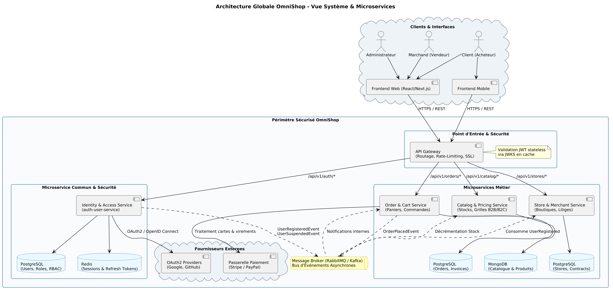

# Dossier Technique — Plateforme OmniShop
> **Projet AWD : Architecture Orientée Microservices**  
> **Livrable : Validation Intermédiaire (Séance 4)**  

---

## Sommaire
1. [Description du Sujet & Problématique](#1-description-du-sujet--problématique)
2. [Acteurs & Matrice des Fonctionnalités](#2-acteurs--matrice-des-fonctionnalités)
3. [Découpage en Microservices & Responsabilités](#3-découpage-en-microservices--responsabilités)
4. [Gestion des Données par Service (Polyglot Persistence)](#4-gestion-des-données-par-service)
5. [Interactions & Protocoles de Communication](#5-interactions--protocoles-de-communication)
6. [Diagramme d'Architecture Globale](#6-diagramme-darchitecture-globale)
7. [Sécurité, Authentification & Gouvernance](#7-sécurité-authentification--gouvernance)
8. [Organisation du Travail & Gestion de Projet](#8-organisation-du-travail--gestion-de-projet)

---

## 1. Description du Sujet & Problématique

### Contexte
Le commerce électronique moderne évolue vers des modèles hybrides où cohabitent acheteurs particuliers (B2C) et professionnels (B2B). Les architectures monolithiques traditionnelles peinent à absorber les variations de charge (pics de soldes, campagnes promotionnelles) et imposent un couplage fort entre les domaines fonctionnels (gestion de stock, authentification, flux de paiement).

### Problématique
Comment concevoir une place de marché e-commerce scalable, résiliente et sécurisée, capable de :
1. Séparer strictement les périmètres et permissions des acteurs (acheteurs, marchands, administrateurs).
2. Appliquer une double tarification dynamique (prix TTC grand public vs remises négociées HT pour les professionnels).
3. Garantir la continuité de service des fonctionnalités critiques (consultation de catalogue) même en cas de panne temporaire d'un service aval (paiement ou notification).

### Solution Proposée : OmniShop
Une architecture distribuée en microservices conteneurisés (Docker), articulée autour d'une **API Gateway** assurant le point d'entrée unique, d'un **service d'identité (IAM)** pour l'authentification centralisée, et d'un bus de messages asynchrone (**RabbitMQ**) pour découpler les flux métier.

---

## 2. Acteurs & Matrice des Fonctionnalités

*(Se référer au diagramme de cas d'utilisation UML : `Documentation/Diagrams/use_case_omnishop.png`)*

### 2.1 Les Acteurs
- **Client (Acheteur) :**
  - Recherche et filtrage dans le catalogue produits.
  - Gestion d'un panier persistant multi-articles.
  - Passage de commande avec validation d'adresses et choix du transporteur.
  - Suivi d'expédition et historique d'achats.
- **Marchand (Vendeur) :**
  - Paramétrage de sa boutique (coordonnées, politiques d'expédition/retour).
  - Gestion du catalogue et des stocks temps réel avec tarification B2B et B2C.
  - Traitement et préparation des commandes clients, émission des bordereaux.
  - Consultation des tableaux de bord analytiques (chiffre d'affaires, panier moyen).
- **Administrateur (Gestionnaire de la Plateforme) :**
  - Modération et gestion des comptes utilisateurs (clients et marchands).
  - Gestion des formules d'abonnements marchands et perception des commissions.
  - Arbitrage des litiges clients/vendeurs et surveillance globale de conformité.

### 2.2 Règle d'Inclusion Clé
- **`Passer commande` $\rightarrow$ `<<include>>` $\rightarrow$ `Payer la commande`** : Tout processus de validation d'achat implique obligatoirement la confirmation transactionnelle du paiement.

---

## 3. Découpage en Microservices & Responsabilités

L'architecture découpe le système en 4 microservices métier autonomes complétés par une brique commune transverse :

```
                                 [ Clients Web & Mobile ]
                                            │
                                            ▼
                                   [ API Gateway ]
                     ┌──────────────────────┼──────────────────────┐
                     ▼                      ▼                      ▼
           [ identity-service ]   [ catalog-service ]    [ order-service ]
             (PostgreSQL/Redis)       (MongoDB)            (PostgreSQL)
                     │                      ▲                      ▲
                     └───────────────┐      │                      │
                                     ▼      │                      │
                          [ Message Broker : RabbitMQ / Kafka ] ───┘
                                     ▲
                                     │
                             [ store-service ]
                               (PostgreSQL)
```

| Microservice | Membre Référent | Responsabilités Principales |
| :--- | :--- | :--- |
| **`identity-service`** *(IAM)* | **Membre 1** | Inscription/connexion, OAuth2/OpenID Connect (Google, GitHub), RBAC, émission JWT (RS256) & sessions Redis. |
| **`catalog-service`** | Membre 2 | Fiches produits, catégories, gestion des stocks temps réel, grille tarifaire B2C/B2B. |
| **`order-service`** | Membre 3 | Gestion des paniers, passage de commande, intégration passerelle de paiement (Stripe) et facturation. |
| **`store-service`** | Membre 4 | Configuration des boutiques marchandes, suivi des commissions, gestion des litiges et réclamations. |
| **Brique Commune** | **Équipe** | Modèle de sécurité partagé, convention d'API REST, passerelle API Gateway et bus d'événements. |

---

## 4. Gestion des Données par Service

Chaque microservice applique le pattern **Database per Service**, garantissant un découplage total des schémas :

| Service | Technologie de BDD | Justification Technique |
| :--- | :--- | :--- |
| **`identity-service`** | **PostgreSQL** + **Redis** | PostgreSQL pour l'intégrité relationnelle stricte (clés étrangères `Users` $\leftrightarrow$ `Roles`). Redis pour la révocation instantanée des Refresh Tokens et le rate-limiting. |
| **`catalog-service`** | **MongoDB** | Schéma NoSQL flexible adapté à des fiches produits aux attributs hétérogènes (tailles, couleurs, fiches techniques B2B). |
| **`order-service`** | **PostgreSQL** | Propriétés ACID indispensables pour la conformité financière des commandes, factures et lignes de paiement. |
| **`store-service`** | **PostgreSQL** | Relations strictes entre marchands, boutiques, commissions et historiques de litiges. |

---

## 5. Interactions & Protocoles de Communication

### 5.1 Communications Synchrones (REST / HTTPS / JWKS)
- **API Gateway $\rightarrow$ Microservices :** Routage inverse HTTP/2 basé sur les préfixes d'URL (`/api/v1/auth`, `/api/v1/catalog`, etc.).
- **Validation Stateless JWT via JWKS :** L'API Gateway met en cache la clé publique RSA du service d'identité (`GET /.well-known/jwks.json`). À chaque requête, elle valide la signature sans générer de charge réseau sur le service d'authentification.

### 5.2 Communications Asynchrones (AMQP / RabbitMQ)
Les opérations non critiques pour la réponse immédiate sont déléguées au bus d'événements :
- **`UserRegisteredEvent` :** Émis par `identity-service` $\rightarrow$ Consommé par `store-service` (si marchand, instanciation automatique de la boutique en mode brouillon) et par un service de notification.
- **`OrderPlacedEvent` :** Émis par `order-service` $\rightarrow$ Consommé par `catalog-service` pour décrémenter le stock physique sans bloquer la commande client.
- **`UserSuspendedEvent` :** Émis par `identity-service` $\rightarrow$ Invalidation immédiate des sessions et suspension des boutiques actives.

---

## 6. Diagramme d'Architecture Globale

Le diagramme d'architecture détaillée du système est disponible en haute définition dans [`Documentation/Diagrams/architecture_globale_omnishop.png`](Diagrams/architecture_globale_omnishop.png) :



---

## 7. Sécurité, Authentification & Gouvernance

### Authentification Hybride
1. **Identifiants Locaux :** Email validé et mot de passe chiffré à l'aide d'algorithmes à mémoire dure (**Argon2id** ou BCrypt avec coût 12).
2. **Fédération d'Identité :** Authentification moderne **OAuth2 / OpenID Connect** (Google, GitHub) pour une expérience sans friction.

### Modèle d'Autorisation RBAC
Trois rôles préconfigurés avec héritage de permissions :
- `ROLE_CLIENT` : Consultation, panier, commande, historique personnel.
- `ROLE_MERCHANT` : Gestion de boutique, fiches articles, consultation des commandes propres, analytique.
- `ROLE_ADMIN` : Accès global de supervision, suspension de comptes, arbitrage.

### Gestion des Sessions
- **Access Token JWT :** Durée de vie courte (15 minutes), asymétrique (RS256), transporté en en-tête `Authorization: Bearer <token>`.
- **Refresh Token :** Aléatoire, sécurisé (UUIDv4/CryptoHash), durée de vie de 7 jours, indexé sous Redis avec révocation immédiate en cas de déconnexion.

---

## 8. Organisation du Travail & Gestion de Projet

- **Méthodologie :** Approche Agile / Kanban pilotée sous GitHub Projects.
- **Cycle Git :** 
  - Branche `main` protégée (déploiements stables).
  - Branches fonctionnelles par microservice (`feature/iam-oauth2`, `feature/catalog-crud`).
  - Validation par revues de code (Pull Requests) obligatoires.
- **Planning Prévisionnel :**
  - *Séance 4 (actuelle) :* Cadrage, modélisation fonctionnelle & technique, contrats d'API.
  - *Séances 5 & 6 :* Implémentation des microservices et conteneurisation Docker.
  - *Séance 7 :* Intégration globale avec API Gateway, tests d'intégration et démo finale.
