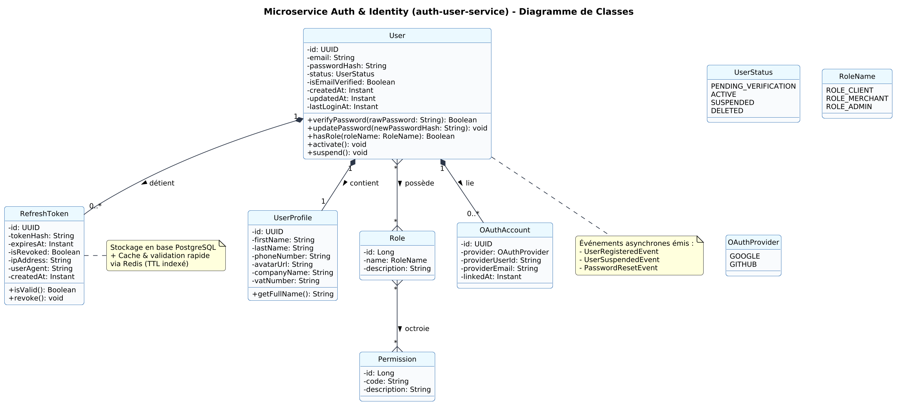
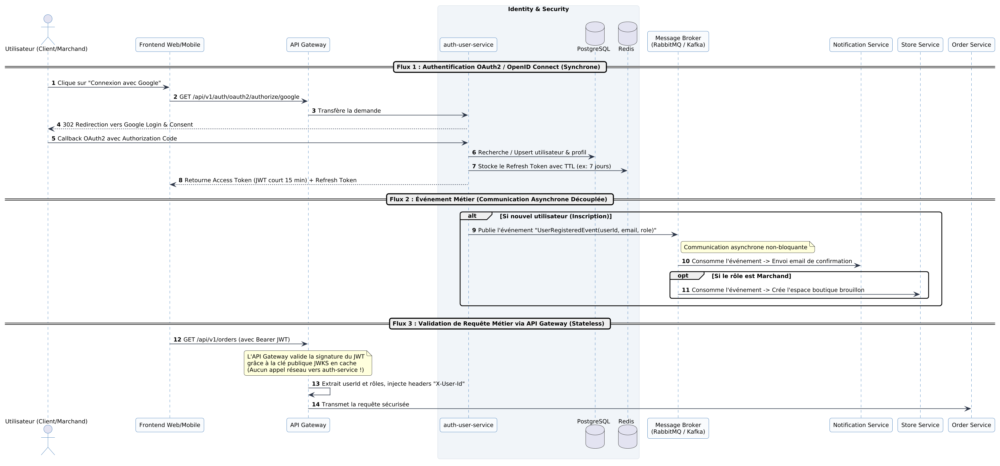

# Fiche Individuelle — Membre 1 : Identity & Access Service

**Étudiant responsable :** Membre 1  
**Projet :** Plateforme OmniShop (Projet AWD)  
**Livrable :** Validation Intermédiaire — Séance 4  

---

## 1. Mission & Périmètre du Microservice

> **Mission centrale :** Gérer l'intégralité du cycle de vie des utilisateurs et sécuriser l'accès à l'ensemble de la plateforme OmniShop.

### Responsabilités Métier :
1. **Inscription et connexion :**
   - Inscription locale par identifiants (Email validé + mot de passe haché par Argon2/BCrypt).
   - Authentification fédérée moderne via **OAuth2 / OpenID Connect** (Google, GitHub) pour une friction d'accès minimale.
2. **Gestion des profils utilisateurs :**
   - Fiches profils extensibles : informations personnelles du client, coordonnées de facturation, profil entreprise et numéro de TVA pour les marchands.
3. **Gestion des rôles et des permissions (RBAC - Role-Based Access Control) :**
   - Définition granulaire des autorisations.
   - *Exemple concret :* Un **client débutant (acheteur B2C)** accède uniquement à la recherche, au panier et à ses commandes ; un **vendeur (marchand)** dispose d'un espace dédié pour administrer son catalogue, ajuster les prix et expédier les commandes ; un **administrateur** supervise les litiges et modère les utilisateurs.
4. **Authentification et Autorisation :**
   - Émission de jetons **JWT signés asymétriquement (RS256)** contenant l'identité et les rôles revendiqués (*claims*).
   - Exposition du trousseau public **JWKS** (`/.well-known/jwks.json`) permettant à l'API Gateway de valider les requêtes en mode *stateless* sans surcharger le service.
5. **Gestion des sessions et Révocation :**
   - Modèle double token : **Access Token** à durée de vie courte (15 minutes, stateless) + **Refresh Token** à durée de vie longue (7 jours) avec détection de rejeu.
   - Stockage et invalidation temps réel dans **Redis** (liste noire immédiate en cas de déconnexion ou de compromission de compte).

---

## 2. Choix Technologiques & Justifications

| Composant | Technologie retenue | Justification technique |
| :--- | :--- | :--- |
| **Langage & Framework** | Java (Spring Boot 3 + Spring Security 6) ou Node.js (NestJS / TypeScript) | Robustesse enterprise, support natif de OAuth2 Client / Resource Server, excellente performance. |
| **Base de Données Principale** | **PostgreSQL** | Garantie d'intégrité référentielle ACID stricte pour les relations `Users` $\leftrightarrow$ `Roles` $\leftrightarrow$ `Permissions`. |
| **Cache & Sessions** | **Redis** | Accès mémoire ultra-rapide (< 2 ms) pour la validation des Refresh Tokens, la gestion des listes de révocation et le rate-limiting anti brute-force. |
| **Message Broker** | **RabbitMQ** (ou Apache Kafka) | Émission d'événements asynchrones non-bloquants pour découpler l'authentification des autres microservices. |

---

## 3. Conception UML : Diagramme de Classes

Le diagramme ci-dessous modélise la structure de données du microservice :



### Description des entités :
- **`User`** : Entité racine encapsulant l'état du compte (`status` : ACTIVE, SUSPENDED, etc.), le condensat sécurisé du mot de passe et l'historique des connexions.
- **`UserProfile`** : Données métier du profil (nom, téléphone, informations professionnelles éventuelles).
- **`Role` & `Permission`** : Modèle RBAC normalisé permettant d'associer un ensemble dynamique de droits d'accès à chaque type d'acteur.
- **`OAuthAccount`** : Liaison sécurisée entre un compte local et un identifiant externe OAuth2 (ex. ID Google ou GitHub).
- **`RefreshToken`** : Jeton persistant traçant l'adresse IP et l'empreinte de l'appareil (*User-Agent*), avec horodatage d'expiration et indicateur de révocation.

---

## 4. Interactions avec les Autres Microservices



### A. Communications Synchrones (REST / JWKS)
- **API Gateway $\rightarrow$ `identity-service` :** Au démarrage et périodiquement, l'API Gateway interroge l'endpoint public `GET /.well-known/jwks.json` pour mettre en cache la clé publique RSA.
- **Contrôle d'accès stateless :** À chaque appel client, l'API Gateway décode et valide la signature cryptographique du JWT sans effectuer d'appel réseau synchrone vers le service d'authentification. Elle enrichit la requête en injectant les en-têtes `X-User-Id` et `X-User-Roles` transmis aux microservices cibles (`order-service`, `catalog-service`).

### B. Communications Asynchrones (Message Broker)
Le service publie des événements métiers diffusés via RabbitMQ :
1. **`UserRegisteredEvent`** : 
   - Publié dès qu'un nouvel utilisateur crée son compte.
   - Consommé par `notification-service` (envoi du mail de bienvenue).
   - Consommé par `store-service` (si le rôle est `ROLE_MERCHANT`, création automatique d'un espace boutique au statut brouillon).
2. **`UserSuspendedEvent`** :
   - Émis lorsqu'un administrateur suspend un utilisateur.
   - Provoque la purge immédiate de toutes les sessions actives dans Redis et la notification aux services métier.

---

## 5. Contrats d'API du Microservice (OpenAPI / Swagger)

### 1. Inscription Locale
- **Endpoint :** `POST /api/v1/auth/register`
- **Body :**
  ```json
  {
    "email": "client@example.com",
    "password": "Password123!",
    "role": "ROLE_CLIENT",
    "firstName": "John",
    "lastName": "Doe"
  }
  ```
- **Réponses :**
  - `201 Created` : Compte créé, retourne l'ID et l'état.
  - `400 Bad Request` : Format d'email invalide ou mot de passe trop faible.
  - `409 Conflict` : L'adresse email est déjà enregistrée.

### 2. Connexion Locale
- **Endpoint :** `POST /api/v1/auth/login`
- **Body :**
  ```json
  {
    "email": "client@example.com",
    "password": "Password123!"
  }
  ```
- **Réponses :**
  - `200 OK` :
    ```json
    {
      "tokenType": "Bearer",
      "accessToken": "eyJhbGciOiJSUzI1NiIs...",
      "expiresIn": 900,
      "refreshToken": "d7b4c92e-5f8a-4f21-..."
    }
    ```
  - `401 Unauthorized` : Identifiants incorrects.
  - `403 Forbidden` : Compte suspendu.

### 3. Renouvellement de Session (Refresh Token)
- **Endpoint :** `POST /api/v1/auth/refresh`
- **Body :** `{"refreshToken": "d7b4c92e-5f8a-4f21-..."}`
- **Réponses :** `200 OK` (nouveau couple de jetons) ou `401 Unauthorized` (jeton expiré ou révoqué).

### 4. Fédération OAuth2 / OpenID Connect
- **`GET /api/v1/auth/oauth2/authorize/{provider}`** : Redirige l'utilisateur vers la page de consentement Google/GitHub.
- **`GET /api/v1/auth/oauth2/callback/{provider}`** : Réception du code d'autorisation, échange avec le fournisseur et émission des tokens applicatifs OmniShop.

### 5. Clé Publique de Validation
- **`GET /.well-known/jwks.json`** : Exposition standardisée des clés de signature publique pour l'API Gateway et les microservices internes.

---

## 6. Votre Speech de 1 Minute (Séance 4) 🎤

> *"Bonjour à tous. Dans le cadre de notre projet OmniShop, j’ai pris en charge la conception et la mise en œuvre du microservice central **Identity & Access Service**.*
>
> *Notre mission consiste à sécuriser l'accès à la plateforme tout en offrant un parcours utilisateur fluide. Pour cela, le service prend en charge à la fois l'authentification locale sécurisée et la fédération via **OAuth2 et OpenID Connect**, permettant une connexion rapide via Google ou GitHub.*
>
> *Pour répondre au besoin de cloisonnement strict entre nos profils — par exemple un acheteur particulier et un vendeur marchand qui disposent d'espaces et de droits totalement distincts — j'ai conçu un modèle d'autorisation **RBAC** robuste appuyé sur **PostgreSQL** pour l'intégrité relationnelle.*
>
> *Côté architecture, nous adoptons des jetons **JWT asymétriques RS256** couplés à des Refresh Tokens gérés en cache sous **Redis** pour permettre une révocation instantanée. Enfin, notre service communique de façon **stateless** avec l'API Gateway grâce au standard JWKS, et diffuse des événements asynchrones sur **RabbitMQ** comme l'événement `UserRegistered`, garantissant un découplage total avec les microservices métier."*
