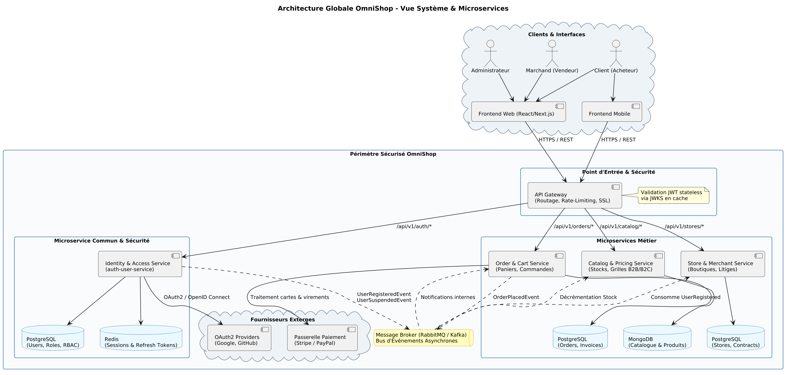
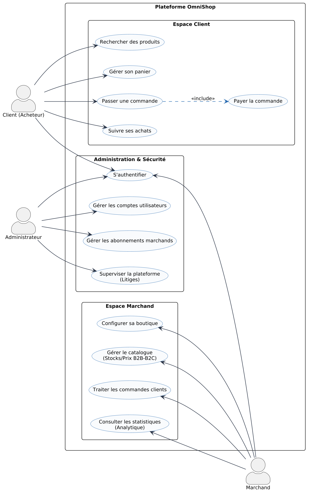

# OmniShop — Plateforme E-Commerce Hybride B2B / B2C
> **Projet AWD — Architecture Logicielle & Microservices (Validation Intermédiaire - Séance 4)**

Bienvenue sur le dépôt officiel du projet **OmniShop**. Cette plateforme e-commerce multi-acteurs est conçue selon une architecture orientée microservices moderne, résiliente et hautement disponible.

---

## 👥 Répartition de l'Équipe & Rôles

| Membre | Microservice Attribué | Responsabilités Clés |
| :--- | :--- | :--- |
| **Membre 1** *(Lead IAM)* | **Identity & Access Service** | Inscription/connexion, OAuth2/OpenID Connect (Google, GitHub), RBAC, JWT (RS256) & sessions Redis |
| **Membre 2** | **Catalog & Pricing Service** | Catalogue produits, gestion des stocks temps réel, double tarification (B2C TTC / B2B HT) |
| **Membre 3** | **Order & Cart Service** | Gestion des paniers, passage de commande, flux de facturation et paiements sécurisés |
| **Membre 4** | **Store & Merchant Service** | Configuration des boutiques marchandes, analytique vendeurs, gestion et modération des litiges |
| **Équipe entière** | **Brique Commune Transverse** | Modèle de sécurité partagé, convention d'API REST, passerelle API Gateway et bus d'événements |

---

## 📐 Architecture & Modélisation du Système

### 1. Diagramme d'Architecture Globale
L'application repose sur un découpage en microservices indépendants, protégés par une **API Gateway**, orchestrés par **Docker** et communiquant via des flux synchrones (REST/JWKS) et asynchrones (Message Broker **RabbitMQ**) :



### 2. Diagramme de Cas d'Utilisation Général
Délimite le périmètre fonctionnel entre le **Client (Acheteur)**, le **Marchand (Vendeur)** et l'**Administrateur** :



---

## 🗂️ Organisation du Dépôt Git

Conformément aux exigences de cadrage du projet AWD, le dépôt est structuré comme suit :

```
projet-awd-main/
├── Backend/                                    # Code source des microservices
├── Frontend/                                   # Application cliente (Web / Mobile)
├── Documentation/                              # Dossiers techniques et livrables
│   ├── Dossier_Technique_OmniShop.md           # Dossier technique complet (Rendu Blackboard)
│   ├── Fiche_Membre1_Identity_Access_Service.md# Spécification détaillée du microservice IAM
│   ├── Diagramme_Cas_Utilisation_OmniShop.pdf  # Fiche PDF haute définition du cas d'utilisation
│   ├── Fiche_Individuelle_Membre1_Identity_Access.pdf # Fiche individuelle 2 pages (Speech & API)
│   │
│   ├── Diagrams/                               # Fichiers sources PlantUML, PNG et SVG
│   │   ├── architecture_globale_omnishop.*     # Diagramme d'architecture globale
│   │   ├── class_diagram_auth_service.*        # Diagramme de classes IAM
│   │   ├── sequence_auth_flow.*                # Diagramme de séquence (OAuth2 & Broker)
│   │   └── use_case_omnishop.*                 # Diagramme de cas d'utilisation
│   │
│   └── Presentation/                           # Supports de soutenance orale
│       └── presentation_seance_4.md            # Trame des slides (Groupe + 1 min par membre)
│
└── README.md                                   # Présentation générale du projet
```

---

## 🚀 Livrables Clés pour la Séance 4

- 📄 **Dossier Individuel Membre 1 (IAM) :** [`Documentation/Fiche_Individuelle_Membre1_Identity_Access.pdf`](Documentation/Fiche_Individuelle_Membre1_Identity_Access.pdf)
- 📊 **Dossier Cas d'Utilisation Général :** [`Documentation/Diagramme_Cas_Utilisation_OmniShop.pdf`](Documentation/Diagramme_Cas_Utilisation_OmniShop.pdf)
- 🖥️ **Support de Présentation Orale :** [`Documentation/Presentation/presentation_seance_4.md`](Documentation/Presentation/presentation_seance_4.md)
- 📋 **Spécification Technique Complète :** [`Documentation/Dossier_Technique_OmniShop.md`](Documentation/Dossier_Technique_OmniShop.md)

---

## 🔒 Sécurité & Contrôle d'Accès

- **Authentification Hybride :** Identifiants locaux (hachage Argon2/BCrypt) + Fédération **OAuth2 / OpenID Connect** (Google, GitHub).
- **Autorisation RBAC :** Contrôle d'accès basé sur les rôles (`ROLE_CLIENT`, `ROLE_MERCHANT`, `ROLE_ADMIN`).
- **Validation Stateless :** Signature asymétrique RSA (RS256) validée directement par l'API Gateway via l'endpoint public `/.well-known/jwks.json`.
- **Gestion des Sessions :** Couple Access Token court (15 min) + Refresh Token longue durée géré et révocable en temps réel sous **Redis**.
